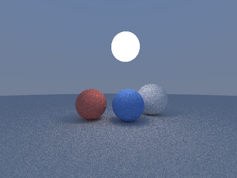

# pathtracer_roc

a minimal path tracer in [Roc](https://www.roc-lang.org): diffuse spheres, one emissive sphere, a sky gradient, xorshift random sampling, written as a P6 PPM. one file, no packages beyond the platform.



## run

needs a [new-compiler nightly](https://github.com/roc-lang/nightlies/releases) of Roc; the code is checked against `nightly-2026-08-30-34e7489` and basic-cli 0.22.2.

```sh
roc build --opt=speed --output=pathtracer main.roc
./pathtracer
```

writes `output.ppm`. resolution, samples per pixel and bounce depth are the constants at the top of `main.roc`; 400x300 at 128 samples takes well under a minute.
